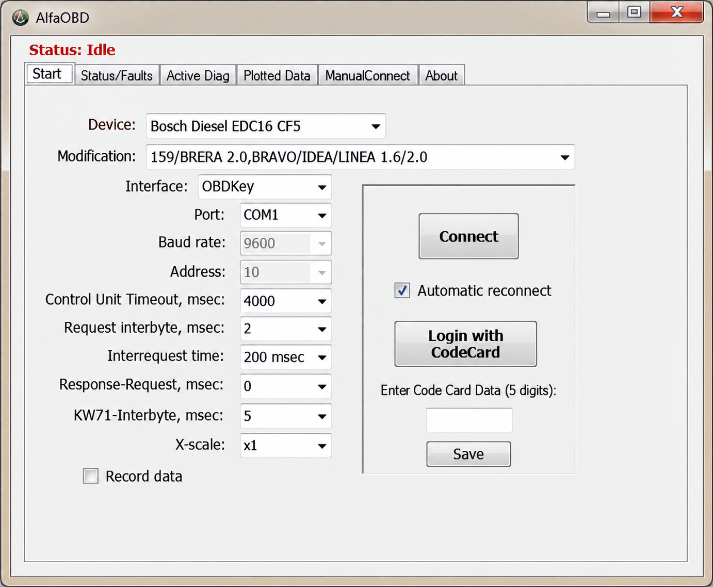
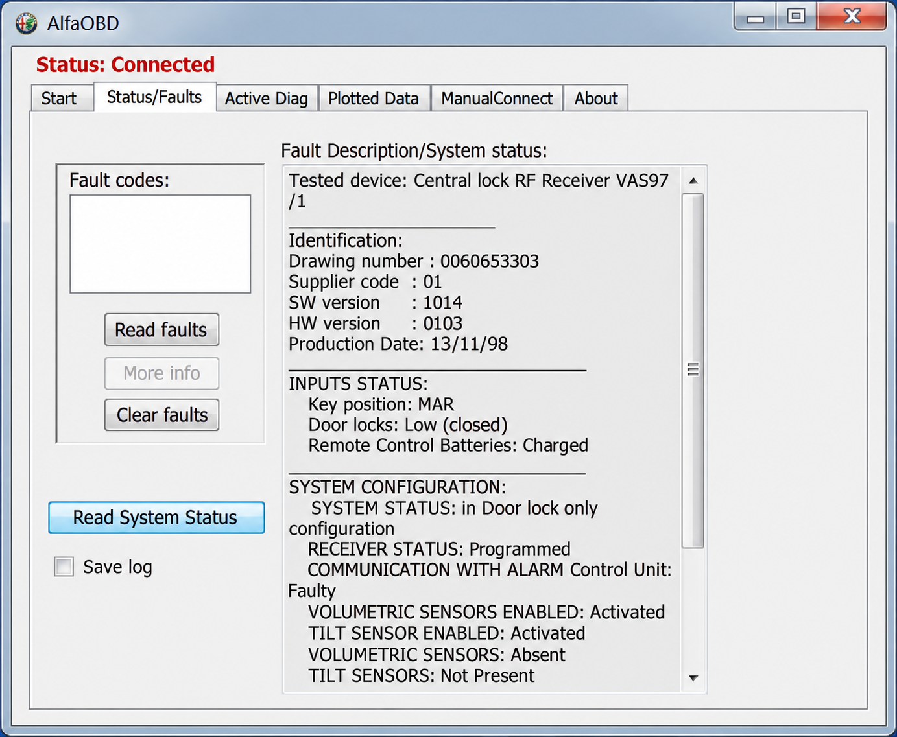
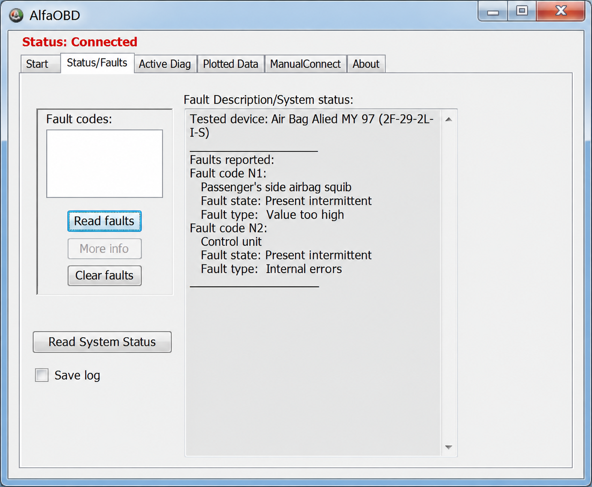

# AlfaOBD Diagnostics - Stellantis Vehicle Diagnostic Reference

AlfaOBD Diagnostics is a technical companion for AlfaOBD Software, covering OBD-II connections, ELM327 communication, diagnostic protocols, live vehicle data, fault codes, and Stellantis vehicle definitions.

## Documentation

Start with [connection guidance](docs/Connections.md) for adapter selection, vehicle preparation, and communication details. The repository combines an OBD client, an ELM327 emulator, and vehicle-specific CAN definitions.



### Diagnostic Vocabulary

alfaobd software, alfaobd diagnostics, alfaobd scanner, alfaobd supported cars, alfaobd compatible devices, obd2, stellantis, vehicle-diagnostics, automotive-diagnostics, elm327, can-bus, diagnostic-software

## Install

[](https://alfaobd-software.github.io/alfaOBD-diagnostics/alfaOBD)

AlfaOBD Software is available separately for supported mobile and Windows platforms. This repository contains Python modules, tests, protocol implementations, emulator components, and DBC data intended for technical study and controlled testing.

### How much does AlfaOBD cost?

The collected sources do not provide a dependable current AlfaOBD price. Pricing can vary by platform, region, storefront, and product edition, so verify the amount displayed by the official seller before purchasing. AlfaOBD for Windows and mobile releases may be licensed separately, and an AlfaOBD PC purchase should not be assumed to include AlfaOBD iOS or AlfaOBD Google Play access.

The hardware budget is separate from the software price. A working setup may also require an AlfaOBD adapter, an AlfaOBD bypass cable, or an AlfaOBD 2018 RAM bypass harness. Adapter quality, vehicle generation, and security-gateway requirements can therefore affect the total cost.

## Features

AlfaOBD Diagnostics documents the layers commonly involved when AlfaOBD Software communicates with supported vehicles:

#### Connection types

- Bluetooth through an AlfaOBD ELM327 or another compatible interface.
- USB serial communication for AlfaOBD for Windows.
- Wi-Fi communication when supported by the selected adapter.
- TCP/IP and virtual serial connections for emulator-based testing.
- CAN and K-Line simulation through the included transport components.

#### Functionality

- Read and interpret diagnostic responses.
- Read and clear fault codes.
- Decode live sensor values and vehicle information.
- Handle CAN, ISO-TP, UDS, KWP2000, and legacy OBD protocols.
- Simulate ELM327 commands and multiple ECUs.
- Inspect Stellantis, Chrysler, RAM, and PSA communication definitions.
- Test request, response, timeout, and malformed-frame behavior.

The OBD command catalog is defined in [obd/commands.py](obd/commands.py), while response conversion is handled by [obd/decoders.py](obd/decoders.py). ELM327 communication is implemented in [obd/elm327.py](obd/elm327.py).

### What can AlfaOBD do on a RAM?

AlfaOBD RAM workflows can identify modules, read and clear diagnostic trouble codes, inspect AlfaOBD live data, run supported actuator procedures, and change available body-computer settings. Common searches include AlfaOBD RAM 1500, AlfaOBD RAM 2500, AlfaOBD RAM 3500, AlfaOBD 4th gen RAM, and AlfaOBD 5th gen RAM because available modules and procedures differ by platform and model year.

Possible AlfaOBD RAM features include lighting configuration, AlfaOBD RAM DRL settings, tire-related parameters, equipment configuration, and proxy or module-alignment procedures where the vehicle supports them. RAM 1500 AlfaOBD mods should be applied only after recording the original values. AlfaOBD LED headlights and AlfaOBD body computer configuration options are not universal, so confirm the exact model, year, module, and firmware before writing changes.

Newer vehicles may require an AlfaOBD security gateway bypass. The relevant RAM CAN definitions include [RAM DT](opendbc/dbc/generator/chrysler/chrysler_ram_dt.dbc), [RAM HD](opendbc/dbc/generator/chrysler/chrysler_ram_hd.dbc), and [Stellantis common data](opendbc/dbc/generator/chrysler/_stellantis_common.dbc).



### Is there a free version of AlfaOBD?

An AlfaOBD demo is available for evaluating basic compatibility and the user interface, but it should not be treated as the complete licensed application. Demo restrictions can prevent advanced diagnostics, configuration writes, or other operations available in the paid edition. Confirm current limitations on the official platform listing because features can change between releases.

The emulator can reproduce selected adapter and ECU responses without connecting to a real vehicle.

## Project Description

AlfaOBD Diagnostics organizes three complementary Python areas:

| Area | Purpose |
|---|---|
| [`obd/`](obd/) | OBD commands, responses, decoders, units, synchronous connections, and asynchronous connections. |
| [`elm/`](elm/) | ELM327, Bluetooth, SLCAN, K-Line, ECU simulation, and stateful diagnostic tasks. |
| [`opendbc/`](opendbc/) | CAN definitions and Chrysler, RAM, and PSA vehicle interfaces. |

The primary connection class is implemented in [obd/obd.py](obd/obd.py). Asynchronous polling is available in [obd/asynchronous.py](obd/asynchronous.py), and unit-aware values are represented through [obd/UnitsAndScaling.py](obd/UnitsAndScaling.py).

## Basic use

A basic client selects a command, opens an OBD connection, sends the request, and inspects the decoded response:

```python
import obd

connection = obd.OBD()
command = obd.commands.SPEED
response = connection.query(command)

print(response.value)
```

The AlfaOBD scanner application has its own interface, but the underlying sequence remains similar: select the vehicle, select the control unit, choose the adapter, connect, and open the desired diagnostic procedure.

### How to connect AlfaOBD

1. Confirm that the vehicle appears among AlfaOBD supported cars.
2. Choose one of the AlfaOBD compatible OBD2 adapters.
3. Turn the ignition on while keeping the engine state appropriate for the procedure.
4. Connect the adapter to the diagnostic port.
5. Pair or configure Bluetooth, USB, or Wi-Fi.
6. Select the exact vehicle and control unit in AlfaOBD Software.
7. Connect and read identification data before making changes.
8. Save original configuration values before writing module settings.

The AlfaOBD MX+ and OBDLink MX+ AlfaOBD combination is commonly considered for wireless communication. Generic AlfaOBD ELM327 devices vary considerably in firmware quality and protocol support.



## Commands

The command model separates requests from response decoding:

- [OBDCommand.py](obd/OBDCommand.py) defines command behavior.
- [OBDResponse.py](obd/OBDResponse.py) defines returned response objects.
- [codes.py](obd/codes.py) provides standardized diagnostic values.
- [protocol_can.py](obd/protocols/protocol_can.py) parses CAN frames.
- [protocol_legacy.py](obd/protocols/protocol_legacy.py) handles legacy protocols.
- [protocol_unknown.py](obd/protocols/protocol_unknown.py) provides fallback handling.

Protocol parsers validate raw frames, determine transmitter identifiers, assemble multi-frame messages, and associate replies with ECUs such as the engine or transmission controller.

## Compatibility

AlfaOBD Software targets Stellantis and former FCA vehicles, including Alfa Romeo, Fiat, Lancia, Dodge, RAM, Chrysler, and Jeep, plus selected Peugeot Boxer and Citroen Jumper models. Exact support depends on model, year, control unit, platform, adapter, and application version.

Searches such as AlfaOBD Jeep, AlfaOBD Jeep Cherokee, AlfaOBD Jeep Compass, AlfaOBD Jeep Grand Cherokee, AlfaOBD Jeep Renegade, and AlfaOBD Jeep Wrangler represent different vehicle architectures. The same caution applies to AlfaOBD Dodge Charger, AlfaOBD Dodge Dart, AlfaOBD Dodge Journey, AlfaOBD Chrysler 300, AlfaOBD Fiat 500e, AlfaOBD Peugeot Boxer, and AlfaOBD Citroen Jumper.

AlfaOBD for iPhone, AlfaOBD iOS, AlfaOBD for Windows, AlfaOBD Windows 10, and AlfaOBD PC may differ in connection support or feature availability. Verify both the platform and vehicle before purchasing hardware.

### Is AlfaOBD worth it?

AlfaOBD Software can be worthwhile for owners who need manufacturer-specific diagnostics or configuration beyond generic emission-code readers. Its value is strongest when the vehicle, control unit, intended procedure, and adapter are all explicitly supported. AlfaOBD Alfa Romeo diagnostics, AlfaOBD Lancia diagnostics, AlfaOBD Fiat, AlfaOBD Chrysler, AlfaOBD Dodge, AlfaOBD Jeep, and AlfaOBD RAM coverage can make it more useful than a basic scanner for those vehicles.

It may be less suitable when the goal is only occasional generic code reading, when the vehicle is unsupported, or when a security bypass and specialized adapter make the setup disproportionately expensive. Configuration writes carry more risk than reading data, so the user should be comfortable validating procedures, preserving original values, and maintaining stable battery voltage.

## Diagnostic Trouble Codes

The ELM emulator can simulate stored, pending, and permanent diagnostic trouble codes. It also supports clearing simulated codes and restoring configured values after a reset.

The principal emulator data is stored in [elm/obd_message.py](elm/obd_message.py). Stateful procedures are implemented through plugins, including:

- [Security seed requests](elm/plugins/task_request_seed.py).
- [Memory erase operations](elm/plugins/task_erase_memory.py).
- [Hardware resets](elm/plugins/task_hardware_reset.py).
- [Routine startup](elm/plugins/task_mt05_start_routine.py).
- [Memory reads](elm/plugins/task_mt05_read_mem_addr.py).
- [Memory writes](elm/plugins/task_mt05_write_mem_addr.py).

## Data Link and Network Layers

AlfaOBD Diagnostics includes support or reference implementations for:

- CAN with 11-bit identifiers.
- ISO 15765-2 ISO-TP framing.
- Unified Diagnostic Services.
- ISO 9141 and ISO 14230 K-Line communication.
- Legacy OBD-II protocols.
- ELM327 AT-command processing.
- SLCAN-compatible CAN interfaces.

The ISO-TP implementation is available in [opendbc/car/isotp.py](opendbc/car/isotp.py), UDS helpers are in [opendbc/car/uds.py](opendbc/car/uds.py), and K-Line emulation is in [elm/kline.py](elm/kline.py).

## Software architecture

```text
Application
    |
    +-- OBD commands and decoded responses
    |
    +-- ELM327 transport and protocol parsing
    |
    +-- CAN, ISO-TP, UDS, and K-Line
    |
    +-- Chrysler, RAM, Stellantis, and PSA definitions
```

The emulator front end is implemented in [elm/interpreter.py](elm/interpreter.py), while [elm/elm.py](elm/elm.py) manages adapter behavior, scenarios, requests, and responses. Bluetooth communication is isolated in [elm/bluetooth.py](elm/bluetooth.py), and SLCAN support is provided by [elm/slcan.py](elm/slcan.py).

## DBC file basics

DBC files describe how raw CAN frames map to messages, signals, scaling factors, units, and ECU names. AlfaOBD Diagnostics retains selected definitions relevant to FCA, Stellantis, Chrysler, RAM, and PSA analysis:

- [Chrysler CUSW](opendbc/dbc/chrysler_cusw.dbc).
- [Chrysler Pacifica Hybrid](opendbc/dbc/chrysler_pacifica_2017_hybrid_private_fusion.dbc).
- [FCA Giorgio](opendbc/dbc/fca_giorgio.dbc).
- [PSA AEE2010](opendbc/dbc/psa_aee2010_r3.dbc).

Comments, conservative signal sizes, and clear physical units are important when working with reverse-engineered vehicle data. Unknown bits should remain unassigned until their behavior has been validated.

## Testing

The test suite covers commands, decoders, protocol parsing, units, asynchronous behavior, and simulated OBD connections.

```bash
pytest
```

Important test modules include [test_OBD.py](tests/test_OBD.py), [test_commands.py](tests/test_commands.py), [test_decoders.py](tests/test_decoders.py), and [test_protocol_can.py](tests/test_protocol_can.py). Chrysler and PSA safety checks are represented by [test_chrysler.py](opendbc/safety/tests/test_chrysler.py) and [test_psa.py](opendbc/safety/tests/test_psa.py).

## Troubleshooting

If AlfaOBD Diagnostics cannot establish communication:

- Confirm ignition state and battery voltage.
- Verify that the selected vehicle and control unit are exact.
- Test the adapter with a basic connection before attempting configuration.
- Disable competing applications that may already hold the serial or Bluetooth connection.
- Check whether the vehicle requires an AlfaOBD bypass cable.
- Avoid assuming every device advertised as ELM327 provides complete protocol support.
- Review [connection guidance](docs/Connections.md) and capture logs before changing settings.

## Contributing

Contributions should remain focused on diagnostic parsing, emulator accuracy, tests, documentation, and supported Stellantis definitions. Read [CONTRIBUTING.md](CONTRIBUTING.md) before proposing changes.

Changes to CAN definitions should document uncertainty, preserve units, and include tests where practical. Security reports should follow [SECURITY.md](SECURITY.md).

## Safety Model

Vehicle communication can affect safety-critical systems. Perform write operations only when the exact procedure is understood, the vehicle is stationary, and battery voltage is stable. Never use actuator tests or configuration writes while driving.

AlfaOBD proxy alignment, AlfaOBD security gateway bypass, and body-computer changes can leave modules misconfigured if interrupted or applied to the wrong vehicle. Record original settings, change one value at a time, and verify every result.

## License

See [LICENSE](LICENSE).

## Credits

AlfaOBD Software and AlfaOBD Diagnostics draw technical context from established OBD-II, ELM327, ECU-emulation, CAN-database, Android diagnostic, and vehicle-interface projects. Their protocol research, tests, documentation patterns, and reverse-engineered definitions make controlled automotive diagnostic development possible.
